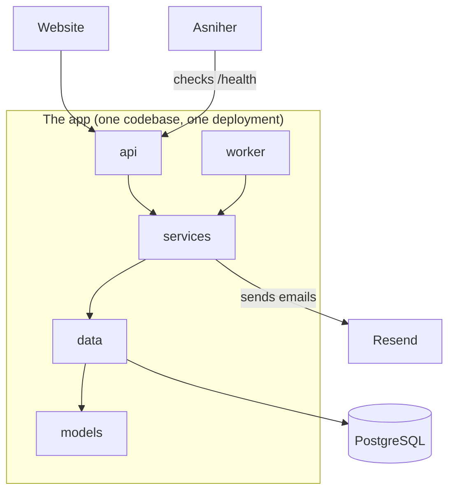

# Salon Booking

A booking app for a small hair salon. A customer picks a service and a time, and then gets a confirmation email.

The email isn't sent during the booking request. The app adds it to a queue in the database, and a background worker sends it through [Resend](https://resend.com). If sending fails, the worker tries again.

| | |
|---|---|
| **Website** | <https://salon-booking-omnf.onrender.com> |
| **Health check** | <https://salon-booking-omnf.onrender.com/health> |
| **Built with** | Node.js, TypeScript, Express, PostgreSQL, Resend |
| **Hosted on** | Render |
| **Monitored by** | Asniher |

## How it's organized

The code has 4 layers. Each layer only calls the layer below it.



| Layer | Folder | What it does |
|---|---|---|
| **api** | `src/api` | Receives requests, checks the input and sends responses. All HTTP code is here. |
| **services** | `src/services` | The business rules, such as "the salon is closed on Sundays" and when to retry an email. |
| **data** | `src/data` | Reads and writes the database. All SQL is here. |
| **models** | `src/models` | Describes the data, such as what an appointment looks like. |

The **worker** (`src/worker`) runs in the background. Like the api, it goes through `services`.

Running `npm run check:layers` checks these rules automatically. It fails if a layer imports something it shouldn't, such as a route using the database directly.

## How the email queue works

1. A customer books an appointment with `POST /appointments`.
2. The app saves the appointment and an email job with the status `pending`. Both are saved in one transaction, so you can't end up with one and not the other.
3. The customer gets a response straight away. No email has been sent yet.
4. Every 5 seconds, the worker looks for email jobs that are ready to send.
5. The worker sends the email through Resend and updates the job:

| What happened | New status | What happens next |
|---|---|---|
| The email was sent | `sent` | Nothing, it's finished |
| It failed, with retries left | `pending` | It tries again after 1, 5, then 15 minutes |
| The 3 retries also failed | `failed` | It stops trying and saves the error |

If several workers run at once, `FOR UPDATE SKIP LOCKED` stops them from taking the same job. If a worker crashes partway through, the job can be picked up again, and an idempotency key tells Resend not to send it twice.

## Run it on your computer

You need [Node.js](https://nodejs.org) 22 or newer. Docker isn't needed.

On Windows, if PowerShell blocks `npm`, type `npm.cmd` instead.

**1. Install the project**

```bash
npm install
cp .env.example .env
```

**2. Edit `.env`**

Set your own `ADMIN_PASSWORD`, and add your `RESEND_API_KEY`. To try the app without a Resend account, set `EMAIL_PROVIDER=fake`.

**3. Start the database**

Run this in its own terminal and leave it open. It runs a real PostgreSQL server on your computer.

```bash
npm run db:local
```

**4. Set up the database and start the app**

Run these in a second terminal:

```bash
npm run migrate
npm run seed
npm run dev
```

`migrate` creates the tables, and `seed` adds the salon's services and some sample bookings.

**5. Open the app**

- Booking page: <http://localhost:3000>
- Admin page: <http://localhost:3000/admin.html>

### Check that everything works

```bash
npm run check
```

This runs the type checker, the layer rules and the unit tests.

### See the retries working

Put these values in `.env` and restart the app. No real emails are sent. Each email fails twice, then succeeds on the third attempt, and you can watch it happen on the admin page.

```env
EMAIL_PROVIDER=fake
FAKE_EMAIL_FAIL_ATTEMPTS=2
EMAIL_RETRY_DELAYS_SECONDS=5,5,5
```

Change the `2` to `99` to see an email end up as `failed`.

## Environment variables

Settings come from environment variables. `.env.example` lists them all with no real keys.

**Required**

| Variable | What it's for |
|---|---|
| `DATABASE_URL` | The PostgreSQL connection address |
| `ADMIN_PASSWORD` | The admin password, at least 8 characters |
| `RESEND_API_KEY` | Your Resend key, needed when `EMAIL_PROVIDER` is `resend` |

**Optional**

| Variable | Default | What it's for |
|---|---|---|
| `EMAIL_PROVIDER` | `resend` | `resend` sends real emails, `fake` sends nothing |
| `EMAIL_FROM` | `Studio Luna <onboarding@resend.dev>` | Who the email comes from |
| `EMAIL_MAX_RETRIES` | `3` | Retries after the first attempt, minimum 3 |
| `EMAIL_RETRY_DELAYS_SECONDS` | `60,300,900` | How long to wait before each retry |
| `FAKE_EMAIL_FAIL_ATTEMPTS` | `0` | With the `fake` provider, how many attempts fail on purpose |
| `START_WORKER` | `true` | Runs the worker inside the web server. Set to `false` to run it separately with `npm run worker` |
| `WORKER_POLL_INTERVAL_MS` | `5000` | How often the worker looks for jobs |
| `PORT` | `3000` | The port the app runs on |
| `SALON_NAME` | `Studio Luna` | The salon name used in emails |
| `SALON_TIMEZONE` | `Europe/Berlin` | Used to work out which times have already passed |
| `BOOKING_RATE_LIMIT_MAX` | `5` | Bookings allowed per visitor every 15 minutes |
| `CLIENT_IP_HEADER` | `cf-connecting-ip` on Render, otherwise empty | The header holding the visitor's real IP, used for rate limits |

**Note:** Resend's test sender, `onboarding@resend.dev`, only delivers to the email address on your own Resend account. To email anyone else, verify a domain in Resend and change `EMAIL_FROM`.

## API

| Request | Who can use it | What it does |
|---|---|---|
| `GET /health` | Everyone | Shows the app and database status |
| `GET /services` | Everyone | Lists services and prices |
| `GET /availability?date=YYYY-MM-DD` | Everyone | Shows the free times on a day |
| `POST /appointments` | Everyone, with a rate limit | Books a time and queues the email |
| `GET /appointments` | Admin | Lists all bookings |
| `GET /email-jobs` | Admin | Lists email jobs. Add `?status=pending`, `sent` or `failed` to filter |
| `GET /email-jobs/:id` | Admin | Shows one email job |

Admin requests need this header: `Authorization: Bearer YOUR_ADMIN_PASSWORD`

## Example requests

These examples use your local app. To try the live one, replace `http://localhost:3000` with the website address at the top.

### Check the app's health

```bash
curl http://localhost:3000/health
```

When everything is working, you get `200`:

```json
{
  "status": "ok",
  "app": { "status": "ok", "uptimeSeconds": 42 },
  "database": { "status": "ok" },
  "emailQueue": { "pending": 0, "sent": 12, "failed": 1 }
}
```

If the database can't be reached, you get `503`:

```json
{
  "status": "error",
  "app": { "status": "ok", "uptimeSeconds": 42 },
  "database": { "status": "unreachable" },
  "emailQueue": null
}
```

### See the free times

```bash
curl "http://localhost:3000/availability?date=2026-11-20"
```

### Book an appointment

```bash
curl -X POST http://localhost:3000/appointments \
  -H "Content-Type: application/json" \
  -d '{"serviceId":1,"customerName":"Ana Test","customerEmail":"ana@example.com","date":"2026-11-20","startHour":10}'
```

Dates must be within the next 60 days, so change the date if this one has passed.

You get `201`, and the email job starts as `pending`:

```json
{ "appointmentId": 3, "emailJob": { "id": 3, "status": "pending" } }
```

If the booking can't be made, you get one of these instead:

| Code | Meaning |
|---|---|
| `400` | The input isn't valid |
| `404` | That service doesn't exist |
| `409` | Someone already booked that time |
| `422` | It breaks a rule, such as a date in the past or a Sunday |
| `429` | Too many bookings from this visitor |

### Check on the email

```bash
curl http://localhost:3000/email-jobs/3 -H "Authorization: Bearer YOUR_ADMIN_PASSWORD"
```

```json
{
  "id": 3,
  "appointmentId": 3,
  "to": "ana@example.com",
  "subject": "Your Studio Luna appointment is confirmed",
  "status": "sent",
  "attempts": 1,
  "maxAttempts": 4,
  "lastError": null,
  "providerMessageId": "..."
}
```

## Deployment

The app runs as one web service on [Render](https://render.com), with the worker running inside it. It needs a server that stays running, because the worker has to keep checking for jobs.

To deploy your own copy:

1. Create a PostgreSQL database on Render.
2. Create a web service from this repo, in the same region as the database, with these commands:
   - **Build:** `npm install --include=dev && npm run build`
   - **Start:** `npm run migrate && npm run seed && npm start`
3. Add the environment variables: `DATABASE_URL` (the database's internal URL), `EMAIL_PROVIDER`, `RESEND_API_KEY` and `ADMIN_PASSWORD`.
4. Set the health check path to `/health`.

It's safe for `migrate` and `seed` to run on every start, because finished migrations are skipped and the seed doesn't create duplicates.

**Free plan limits:** the app sleeps after 15 minutes without traffic, which also pauses the worker. The monitor's regular checks help keep it awake. The free database expires after 30 days.

## Monitoring

Asniher checks `GET /health` every 2 minutes.


