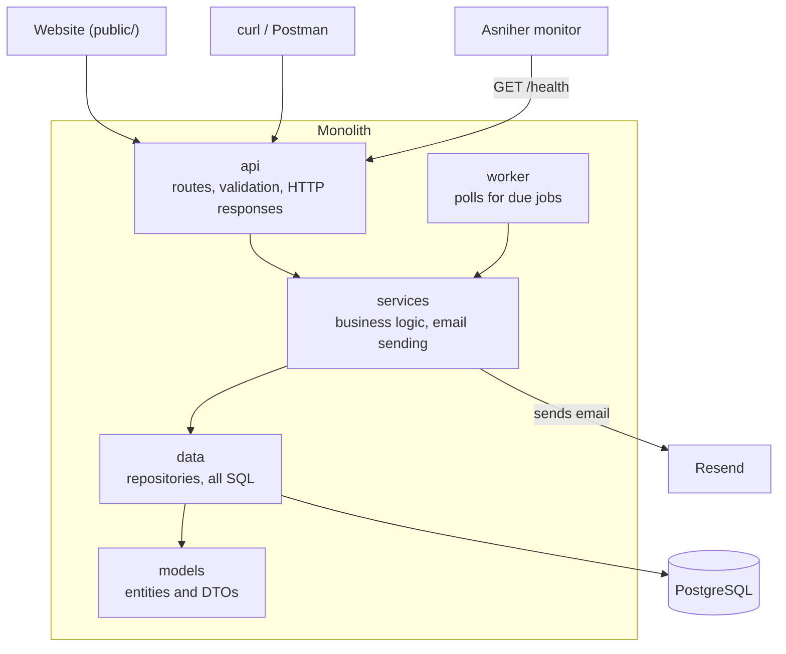
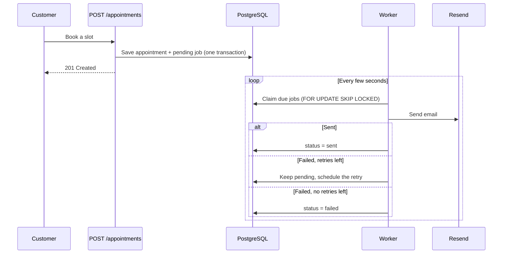
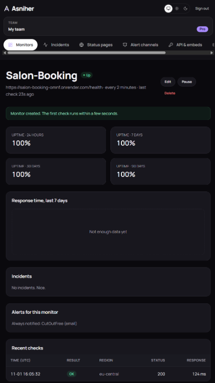

# Salon Booking API

A monolithic backend for a small hair salon. Customers book an appointment on the website and get a confirmation email. The email never goes out during the request: the endpoint saves a job in PostgreSQL, and a background worker sends it through [Resend](https://resend.com), retrying failures.

- **Stack:** Node.js, TypeScript, Express, PostgreSQL, Resend
- **Live app:** <https://salon-booking-omnf.onrender.com>
- **Health endpoint:** <https://salon-booking-omnf.onrender.com/health>

## Architecture

The code is organized into 4 layers, and each layer only calls the one below it.



| Layer | Folder | Responsibility |
|---|---|---|
| api | `src/api` | Routes, request validation and HTTP responses. The only place that knows about HTTP. |
| services | `src/services` | Booking rules, the retry policy and email sending. |
| data | `src/data` | Repositories. The only place with SQL. |
| models | `src/models` | Entities and DTOs. Depends on nothing. |

The worker (`src/worker`) is a second entry point next to the api, so it also goes through `services`. `src/container.ts` wires the layers together.

`npm run check:layers` enforces these rules with [dependency-cruiser](https://github.com/sverweij/dependency-cruiser), and fails if, for example, a route imports a repository or a service imports Express.

### How the email queue works



- **Statuses:** every job in `email_jobs` is `pending`, `sent` or `failed`.
- **Retries:** a failed send is retried 3 times, after 1, 5 and 15 minutes by default. That makes 4 attempts in total.
- **No lost emails:** the appointment and its job are saved in one transaction.
- **No double sends:** `SKIP LOCKED` stops two workers claiming the same job, and an idempotency key stops Resend sending twice if a worker crashes mid-job.

## Setup

You need [Node.js](https://nodejs.org) 22 or newer. Docker isn't required.

```bash
npm install
cp .env.example .env
```

Edit `.env` and set `ADMIN_PASSWORD` and `RESEND_API_KEY`. To try it without a Resend account, set `EMAIL_PROVIDER=fake`.

Start a local PostgreSQL server and leave it running in its own terminal. You can skip this if you point `DATABASE_URL` at another PostgreSQL server.

```bash
npm run db:local
```

In a second terminal, create the tables, add sample data and start the app:

```bash
npm run migrate
npm run seed
npm run dev
```

- Booking page: <http://localhost:3000>
- Admin page: <http://localhost:3000/admin.html>

### Checks

```bash
npm run check
```

This runs the type checker, the layer rules and the unit tests.

### Seeing retries work

Set these values in `.env` and restart the app. Each email fails twice and succeeds on the third attempt, with nothing actually sent:

```env
EMAIL_PROVIDER=fake
FAKE_EMAIL_FAIL_ATTEMPTS=2
EMAIL_RETRY_DELAYS_SECONDS=5,5,5
```

Set `FAKE_EMAIL_FAIL_ATTEMPTS=99` to see a job end up as `failed`.

## Environment variables

| Variable | Required | Default | Description |
|---|---|---|---|
| `DATABASE_URL` | Yes | | PostgreSQL connection string |
| `ADMIN_PASSWORD` | Yes | | Password for the admin page and endpoints, at least 8 characters |
| `RESEND_API_KEY` | With `resend` | | Resend API key |
| `EMAIL_PROVIDER` | No | `resend` | `resend` sends real emails, `fake` sends nothing |
| `EMAIL_FROM` | No | `Studio Luna <onboarding@resend.dev>` | Sender address |
| `EMAIL_MAX_RETRIES` | No | `3` | Retries after the first attempt, minimum 3 |
| `EMAIL_RETRY_DELAYS_SECONDS` | No | `60,300,900` | Wait before each retry |
| `FAKE_EMAIL_FAIL_ATTEMPTS` | No | `0` | Attempts per job that fail on purpose with the `fake` provider |
| `START_WORKER` | No | `true` | Run the worker inside the web server. Set to `false` to use `npm run worker` instead |
| `WORKER_POLL_INTERVAL_MS` | No | `5000` | How often the worker checks for jobs |
| `PORT` | No | `3000` | HTTP port |
| `SALON_NAME` | No | `Studio Luna` | Name used in emails |
| `SALON_TIMEZONE` | No | `Europe/Berlin` | Timezone for working out which slots have passed |
| `BOOKING_RATE_LIMIT_MAX` | No | `5` | Bookings allowed per visitor every 15 minutes |

Resend's test sender, `onboarding@resend.dev`, only delivers to the email address on your own Resend account. To email other people, verify a domain in Resend and change `EMAIL_FROM`.

## API

| Method and path | Access | Description |
|---|---|---|
| `GET /health` | Public | App and database status: 200, or 503 if the database is unreachable |
| `GET /services` | Public | List services and prices |
| `GET /availability?date=YYYY-MM-DD` | Public | Free slots for a day |
| `POST /appointments` | Public, rate limited | Book a slot and queue the confirmation email |
| `GET /appointments` | Admin | List appointments |
| `GET /email-jobs?status=pending\|sent\|failed` | Admin | List email jobs |
| `GET /email-jobs/:id` | Admin | One job's status and attempts |

Admin endpoints need the header `Authorization: Bearer <ADMIN_PASSWORD>`.

### Example requests

**Check health**

```bash
curl http://localhost:3000/health
```

```json
{
  "status": "ok",
  "app": { "status": "ok", "uptimeSeconds": 42 },
  "database": { "status": "ok" },
  "emailQueue": { "pending": 0, "sent": 12, "failed": 1 }
}
```

If the database is unreachable, this returns `503`:

```json
{
  "status": "error",
  "app": { "status": "ok", "uptimeSeconds": 42 },
  "database": { "status": "unreachable" },
  "emailQueue": null
}
```

**See free times**

```bash
curl "http://localhost:3000/availability?date=2026-11-20"
```

**Book an appointment**

```bash
curl -X POST http://localhost:3000/appointments \
  -H "Content-Type: application/json" \
  -d '{"serviceId":1,"customerName":"Ana Test","customerEmail":"ana@example.com","date":"2026-11-20","startHour":10}'
```

Dates must be within the next 60 days, so change the date if this one has passed. The response is `201`, and the email job starts as `pending`:

```json
{ "appointmentId": 3, "emailJob": { "id": 3, "status": "pending" } }
```

Other responses: `400` for invalid input, `404` for an unknown service, `409` if the slot is taken, `422` if it breaks a booking rule such as a date in the past, and `429` for too many bookings.

**Check on the email**

```bash
curl http://localhost:3000/email-jobs/3 -H "Authorization: Bearer YOUR_ADMIN_PASSWORD"
```

```json
{
  "id": 3,
  "appointmentId": 3,
  "to": "ana@example.com",
  "subject": "Your Studio Luna appointment is confirmed",
  "status": "sent",
  "attempts": 1,
  "maxAttempts": 4,
  "lastError": null,
  "providerMessageId": "..."
}
```

## Deployment

The app is one service, deployed on [Render](https://render.com). The worker runs inside the web process by default, so one deployment handles everything. It needs a long-running host, because serverless functions stop between requests and the worker wouldn't keep running.

On Render:

1. Create a PostgreSQL database.
2. Create a web service from this GitHub repo, in the same region as the database, with these commands:
   - **Build:** `npm install --include=dev && npm run build`
   - **Start:** `npm run migrate && npm run seed && npm start`
3. Set `DATABASE_URL` to the database's internal URL, and set `EMAIL_PROVIDER`, `RESEND_API_KEY` and `ADMIN_PASSWORD`.
4. Set the health check path to `/health`.

Migrations and the seed are safe to run on every start: finished migrations are skipped, and the seed won't create duplicates.

Free Render web services sleep after 15 minutes without traffic, which also pauses the worker. Regular health checks from the monitor help keep the app awake, and any pending emails go out as soon as it wakes.

## Monitoring

`GET /health` is monitored on Asniher.


